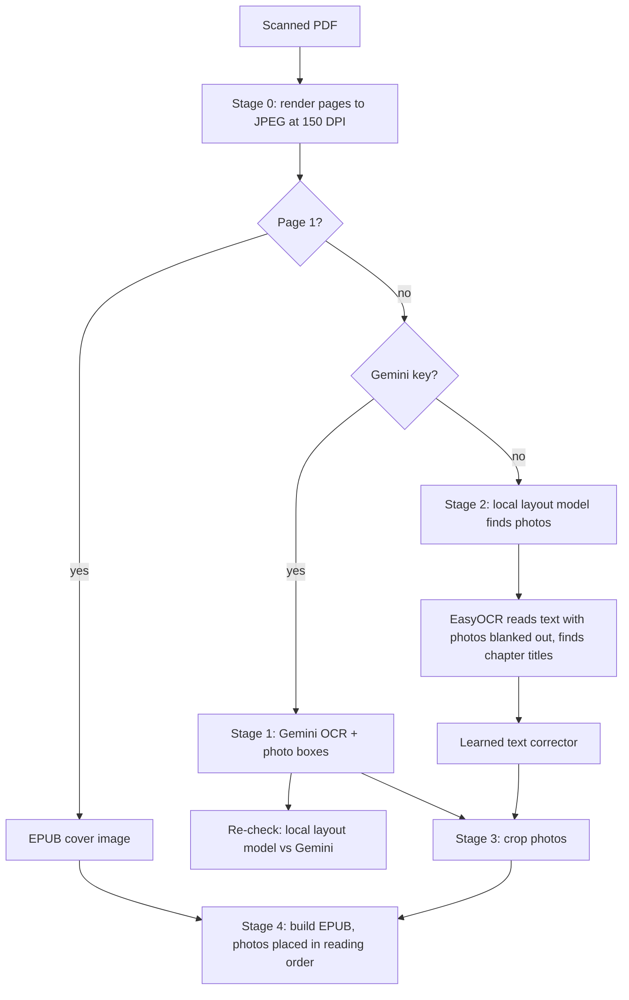
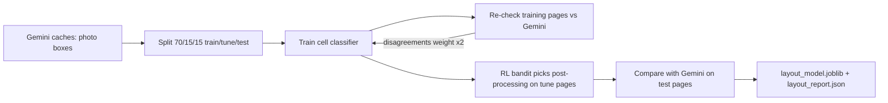
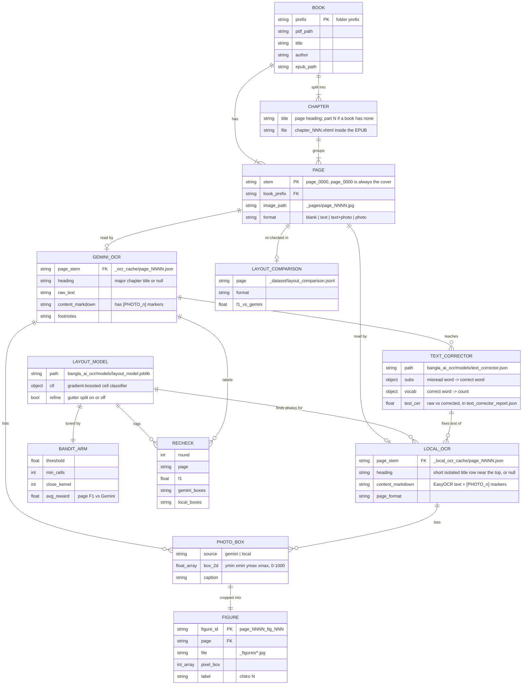

# System design: scanned Bangla PDF → EPUB

Runs fully offline on a CPU laptop (8 GB RAM, no GPU needed). Gemini is optional and only improves text quality.

## Pipeline

## Layout model training loop

## ER diagram

Each entity is a file on disk. `<prefix>` is the book's cache prefix, such as `mahatirtha`.

## Low-resource choices

| Choice | Why |
|---|---|
| Layout model is a gradient-boosted classifier on 864 grid cells per page | Trains in minutes on 2 CPU threads and is under 1 MB |
| EasyOCR on CPU, loaded once, only for pages without Gemini | Peaks at about 1.6 GB RAM |
| `--threads 2` and `--sleep` | Keeps a hot laptop from throttling |
| Text corrector is a word map plus a vocabulary (JSON), learned from offline-vs-Gemini page pairs | Trains in seconds and adds no model to RAM; kept only if held-out CER drops |
| App preview reads page images and caches from disk once a second | The UI never waits on the OCR thread, and no extra copies sit in memory |
| Every stage caches to disk | Stop and resume at any time |
| TrOCR fine-tuning is not in the app | Its 334M-parameter model is too heavy for 8 GB RAM, and the old checkpoint had collapsed. The trainer's REINFORCE loss is now fixed, so retrain from the base model if you use it |

## Known limits

- Offline chapter titles come from a layout rule: a short, isolated row near the top of the page that is taller than the body text or starts low on the page. It was tuned on 11 pages from 3 books. If it finds no titles, the book is split into 20-page parts.
- Offline text accuracy is EasyOCR's. Gemini text is better when a key is available.
- The text corrector was trained on 60 pages and lowers offline error from 3.61% to 3.47% on 12 test pages. Some of its fixes copy Gemini's modern spelling (for example কখনও → কখনো) rather than the printed text. Delete `bangla_ai_ocr/models/text_corrector.json` to turn it off.
- The layout model has only seen three books. Re-train after adding Gemini caches for new books.
